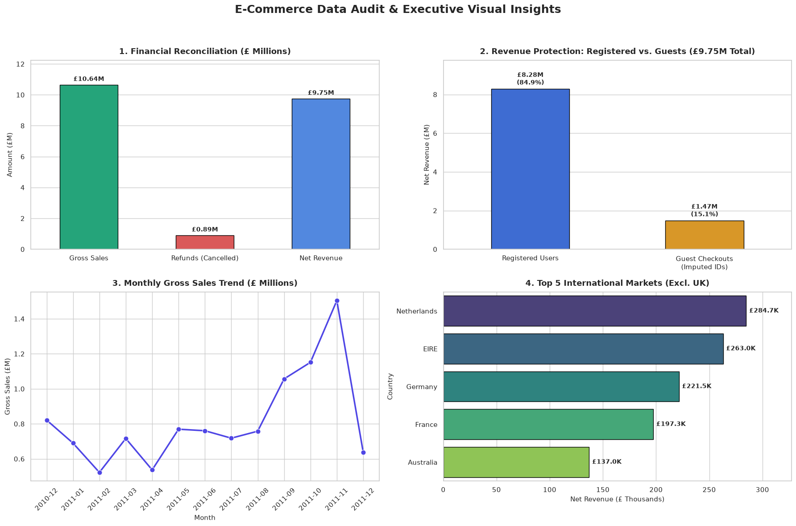

# 🛒 E-Commerce Data Cleaning & Integrity Engineering

## 📌 Project Overview
An end-to-end data cleaning and quality assurance pipeline applied to the **Online Retail Dataset** (541k+ transactions) from the **[UCI Machine Learning Repository](https://archive.ics.uci.edu/dataset/352/online+retail)**. 

The objective was to reconcile distorted revenues, remediate anomalies without blind dropping, and preserve maximum financial value for downstream business intelligence and customer loyalty modeling (RFM).

---

## 📊 Key Highlights & Results
* **Data Scale:** Audited 541,909 raw records down to **534,129 clean transactions (98.56% retention rate)**.
* **Integrity:** Achieved **0 missing values** across all dimensions.
* **Revenue Protection:** Imputed structured Guest IDs (`Guest_<InvoiceNo>`) for 132k+ missing customer records, preserving **£1.47M in revenue (15.08% of total gross sales)**.
* **Inventory vs Returns:** Separated official customer cancellations (£-894K refunds tagged via `Is_Cancelled`) from 1,336 warehouse damage write-offs.
* **Reconciled Net Sales:** Successfully balanced net commercial revenue to **£9,748,131.07**.
---

## 📈 Executive Visual Insights & Financial Audit

---

## 🛠️ Tech Stack & Skills
* **Language & Libraries:** Python, Pandas, NumPy, Matplotlib, Seaborn, ReportLab.
* **Core Competencies:** Business Logic Remediation, Anomaly Detection, Feature Engineering, Financial Reconciliation, Data Quality Auditing.

---

## 📂 Deliverables
1. `cleaning.ipynb`: Comprehensive documented notebook covering exploratory audit, cleaning decisions, and assertion tests.
2. `data_quality_report.pdf`: Executive audit report with raw vs. cleaned benchmarks.
3. `Online Retail Cleaned.csv`: Analysis-ready dataset with engineered features (`TotalPrice`, `Is_Cancelled`, `Is_Guest`).
